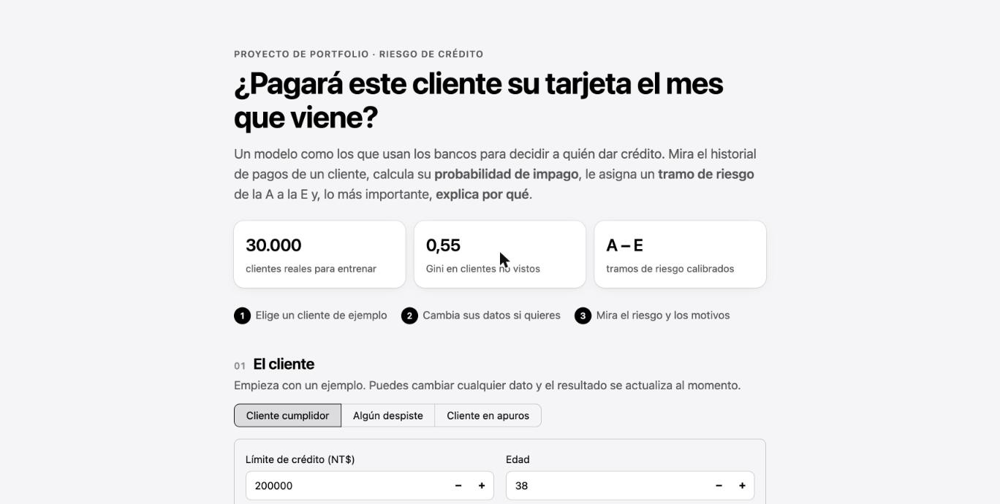
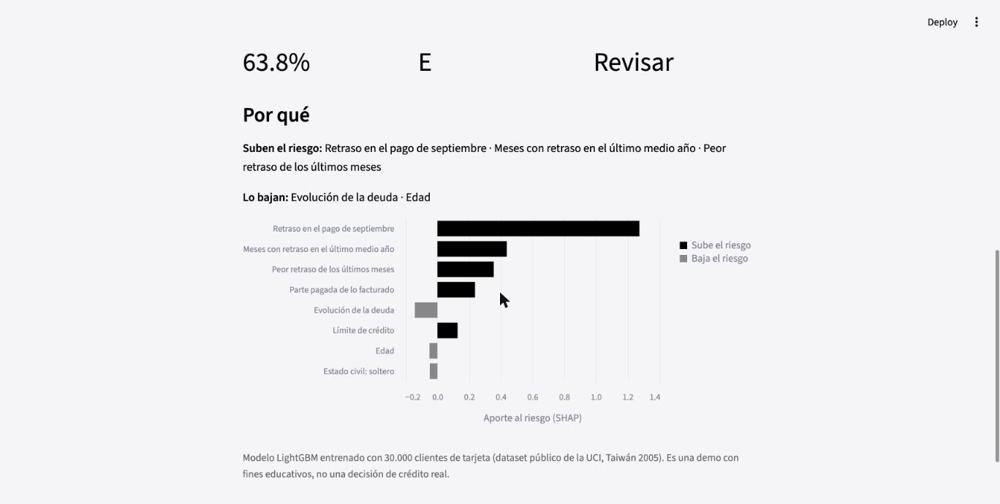
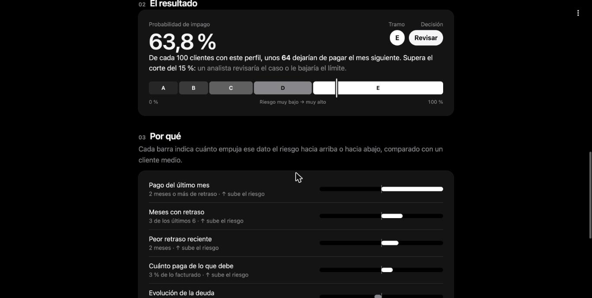

# Scoring de crédito explicable

Modelo de **probabilidad de impago (PD)** para clientes de tarjeta de crédito, construido paso a paso como en un equipo de Riesgo de Crédito: desde ficheros sucios de dos sistemas del banco hasta un modelo que se pueda explicar a cada cliente.

Incluye una **app en Streamlit** (`app/app.py`): cambias los datos de un cliente y ves su probabilidad de impago, su tramo de riesgo, la decisión y los motivos.





Tiene modo claro y oscuro, con un botón arriba a la derecha para elegir.



## Los datos

Parten del dataset público [Default of Credit Card Clients](https://archive.ics.uci.edu/dataset/350/default+of+credit+card+clients) de la UCI: 30.000 clientes de un banco de Taiwán (2005), con su límite, sus pagos de 6 meses y si pagaron al mes siguiente.

Para practicar la limpieza como en un caso real, el original se convirtió en dos extracciones «sucias» de sistemas distintos:

| Fichero | Sistema | Contenido |
| --- | --- | --- |
| `data/raw/extracto_tarjetas_2005-09.csv` | Tarjetas | Límite, estado de pago, facturas, pagos e impago |
| `data/raw/clientes_crm.json` | CRM | Sexo, fecha de nacimiento, estado civil y estudios |

## Resultados

Gini medido con un 30 % de clientes que los modelos no vieron al entrenar (Gini = 2 × AUC − 1; 0 = azar, 1 = perfecto):

| Modelo | Gini entrenamiento | Gini prueba | Diferencia |
| --- | --- | --- | --- |
| Regresión logística (tabla de pesos) | 0,511 | 0,478 | 0,033 |
| LightGBM sin regularizar | 0,632 | 0,548 | 0,084 |
| LightGBM regularizado | 0,614 | 0,547 | 0,067 |
| **LightGBM regularizado y monótono** (modelo final) | | **0,546** | |

LightGBM ordena a los clientes 7 puntos de Gini mejor que la regresión logística. Al regularizarlo (árboles más pequeños y hojas con más clientes) se redujo el sobreajuste sin perder poder en prueba.

Cada decisión se puede explicar con SHAP. Por ejemplo, para tres clientes de prueba:

| Cliente | PD | Motivos principales |
| --- | --- | --- |
| 0 | 20 % | uso alto del límite, límite de crédito bajo, pagos bajos respecto a lo facturado |
| 1 | 62 % | retraso en el pago de septiembre, retrasos importantes en los últimos meses, pagos bajos |
| 2 | 13 % | límite de crédito bajo, pagos bajos respecto a lo facturado, deuda en aumento |

El modelo final obliga a que la relación tenga sentido de negocio en las variables clave (más retraso → más riesgo; más límite o más parte pagada → menos riesgo). Las restricciones sobre el uso del límite costaban 5 puntos de Gini y se quitaron; con el resto, el Gini se mantiene.

Medido como lo haría un banco, sobre los 8.973 clientes de prueba:

| Tramo | % de clientes | PD media | Impago real |
| --- | --- | --- | --- |
| A | 33 % | 7,0 % | 7,6 % |
| B | 34 % | 14,5 % | 15,3 % |
| C | 15 % | 26,4 % | 28,0 % |
| D | 7 % | 43,6 % | 44,4 % |
| E | 11 % | 69,5 % | 65,5 % |

- **Calibración:** por deciles, la PD media y el impago real difieren como mucho 4 puntos.
- **Punto de corte:** suponiendo que un impago cuesta 5 veces más que un buen cliente perdido, el corte de menor coste es PD ≥ 15 %: se revisa al 47 % de los clientes y se evita el 77 % de los impagos.
- **Trato igual:** el sexo no es variable del modelo. Con él aparte, el Gini es 0,532 en hombres y 0,554 en mujeres, y la PD media coincide con el impago real de cada grupo (23,3 % frente a 23,8 %; 20,8 % frente a 21,1 %).

## Lo que se ha hecho

**`notebooks/02_limpieza.ipynb`** resuelve 20 problemas de calidad de datos:
- codificación Windows, separador `;`, líneas de comentario y de control, filas partidas por notas manuales;
- números en formato español, prefijos de moneda, cuatro marcas distintas de «sin dato», valores imposibles y errores de signo;
- etiqueta escrita de 8 formas, duplicados exactos y versiones antiguas de clientes;
- JSON anidado, IDs con formatos distintos entre sistemas y fechas en 4 formatos;
- unión de los dos sistemas, apartando en un fichero de revisión los registros que no casan;
- comprobaciones con `assert` y guardado en **Parquet**.

**`notebooks/03_explorar.ipynb`** analiza quién deja de pagar (tasa media: 22,1 %). El retraso en el último mes es la señal más fuerte: con 2 meses de retraso, la tasa de impago pasa de alrededor del 15 % a cerca del 70 %.

**`notebooks/04_variables.ipynb`** convierte los datos en señales con sentido de negocio y sin información del futuro: meses con retraso, peor retraso, uso del límite, parte pagada de lo facturado y evolución de la deuda. Rellena huecos con la mediana o con la media del propio cliente, marcando a quién se le rellenó.

**`notebooks/05_modelo_logistico.ipynb`** entrena una regresión logística con separación entrenamiento/prueba estratificada, la mide con AUC y Gini y explica cada cliente con los pesos del modelo.

**`notebooks/06_lightgbm.ipynb`** entrena LightGBM con parada temprana sobre un conjunto de validación, lo compara con la regresión logística, detecta el sobreajuste y lo reduce regularizando.

**`notebooks/07_explicar_shap.ipynb`** explica LightGBM con SHAP: qué variables pesan y en qué sentido, interacciones (uso del límite × retraso), la cascada de un cliente y sus motivos principales en lenguaje claro.

**`notebooks/08b_monotonia.ipynb`** añade restricciones de monotonía a LightGBM y comprueba que ninguna variable va en sentido contrario.

**`notebooks/08_medir_como_banco.ipynb`** mide calibración, tramos de rating A–E, el punto de corte por coste y el trato igual entre hombres y mujeres, y guarda el modelo y su configuración en `models/`.

## Cómo ejecutarlo

```bash
conda create -y -n credito python=3.12 && conda activate credito
pip install -r requirements.txt
jupyter lab
```

Ejecuta los cuadernos en orden (`02` … `07`, `08b`, `08`): cada uno lee lo que guardó el anterior en `data/clean/`. En un Mac, LightGBM necesita además `conda install -c conda-forge llvm-openmp`.

Para abrir la app (el modelo ya está guardado en `models/`):

```bash
pip install -r app/requirements.txt
streamlit run app/app.py
```
